<div align="center">


<br/>


[](https://github.com/abhinavxjha/DSAproject/stargazers)
[](https://github.com/abhinavxjha/DSAproject/network/members)

**Find out which appliance is quietly draining your electricity bill, using data structures and algorithms written by hand in C.**

[Features](#-features) · [Demo](#-demo) · [DSA Inside](#-data-structures--algorithms-inside) · [Quick Start](#-quick-start) · [Structure](#-project-structure)

</div>

---

## About

Most people have no idea which appliance pushes their bill up. **Smart Energy Consumption Tracker** lets you enter your appliances (power rating, quantity, daily usage hours) and instantly see daily and monthly consumption, the estimated bill, and which devices use the most energy.

It is also a **Data Structures & Algorithms project**: the storage, searching and sorting are implemented manually with pointers and dynamic memory, without library shortcuts such as `qsort`.

---

## Features

| | Feature | Description |
|---|---|---|
| ➕ | **Appliance management** | Add, view and delete appliances (name, wattage, quantity, hours/day) |
| ⚡ | **Consumption calculation** | Daily and monthly kWh per appliance and in total |
| 💰 | **Bill estimator** | Projected monthly bill from your per-unit tariff |
| 🔍 | **Search** | Find an appliance by ID or name |
| 📊 | **Sorting** | Rank appliances by consumption with a hand-written sort |
| 📈 | **Statistics** | Total, average, highest and lowest consumers |
| 💡 | **Recommendations** | Rule-based saving tips (no AI/ML) |
| 💾 | **Saved data** | Appliances are stored in `data.txt` and reloaded on start |
| ✅ | **Input validation** | Bad input is rejected so the data stays clean |

---

## Demo

<div align="center">

</div>

### Sample calculation

| Appliance | Qty | Watts | Hours/day | kWh/day |
|---|:-:|:-:|:-:|:-:|
| Fan | 2 | 75 | 10 | 1.500 |
| LED Bulb | 3 | 9 | 6 | 0.162 |
| AC | 1 | 1500 | 6 | 9.000 |
| Laptop | 1 | 65 | 4 | 0.260 |
| Mobile Chargers | 2 | 10 | 1 | 0.020 |
| **Total** | | | | **10.942** |

```
Daily consumption   : 10.942 kWh
Monthly (30 days)   : 328.26 kWh
Estimated bill      : Rs 2,626.08   (at Rs 8 / unit)
```

The AC alone is about 82% of the total, which is the kind of insight the tracker is built to surface.

**Formula:** `kWh/day = (watts x quantity x hours) / 1000`

---

## Data Structures & Algorithms Inside

| Concept | Where it's used |
|---|---|
| **Singly linked list** (manual) | Stores all appliances in memory |
| **Linear search** | Look up an appliance by ID or name, O(n) |
| **Merge sort** (manual, no `qsort`) | Sort appliances by consumption, O(n log n) |
| **Dynamic memory** | `malloc` / `free` for every node |
| **File handling** | Save and load `data.txt` |
| **Pointers** | Node linking and list traversal |

---

## Quick Start

You need [MSYS2](https://www.msys2.org/) with the MinGW64 toolchain (GCC and `make`) installed at `C:\msys64`.

### 1. Clone the repo

```bash
git clone https://github.com/abhinavxjha/DSAproject.git
cd DSAproject
```

### 2. Build

```bash
make
```

### 3. Run (Windows PowerShell)

The program needs the MinGW64 runtime libraries on your `PATH`. Add them for the current terminal session, then launch the executable:

```powershell
$env:Path = "C:\msys64\mingw64\bin;" + $env:Path
.\SmartEnergyTracker.exe
```

> The `PATH` change only lasts for the current PowerShell window, so repeat it whenever you open a new terminal. If you don't want to type it each time, use `run.bat` instead.

---

## Project Structure

```
DSAproject2/
├── main.c           # Program entry point and menu
├── energy.c         # Core logic: list, calculations, search, sort, file I/O
├── energy.h         # Structures and function declarations
├── data.txt         # Saved appliance data
├── Makefile         # Build script
├── run.bat          # One-click build and run on Windows
├── banner.svg       # Animated README banner
├── energy-bars.svg  # Animated README chart
└── README.md
```

---

## Roadmap

- [ ] Charts for per-appliance usage
- [ ] CSV import and export
- [ ] Telescopic tariff slabs
- [ ] Monthly history and comparison
- [ ] Graphical interface

---

## What I Learned

- Building a linked list and managing memory manually in C
- Implementing sorting and searching without library helpers
- Persisting data with file handling
- Splitting a C project into header and source files

---

<div align="center">

### If this project helped you, give it a star! ⭐

*Save energy. Learn DSA. Build things.* ⚡

</div>
