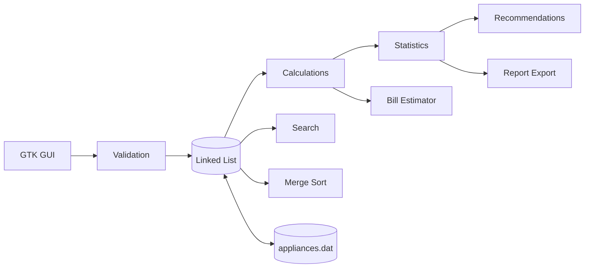

<div align="center">


<br/>


-lightgrey?style=for-the-badge)


[](https://github.com/abhinavxjha/DSAproject/stargazers)
[](https://github.com/abhinavxjha/DSAproject/network/members)

**A desktop app that shows where your electricity goes, built entirely from scratch in C with hand-written data structures and algorithms.**

[Features](#-features) · [Demo](#-demo) · [DSA Inside](#-data-structures--algorithms-inside) · [Quick Start](#-quick-start) · [Structure](#-project-structure) · [Roadmap](#-roadmap)

</div>

---

## About

Most people have no idea which appliance quietly drives up their electricity bill. **Smart Energy Consumption Tracker** lets you add your appliances (power rating, quantity, daily usage hours), then instantly shows daily and monthly consumption, estimated bill, a ranked list of the biggest energy hogs, and practical saving tips.

It is also a **Data Structures & Algorithms showcase**. There is no `qsort`, no STL, and no external container library. The linked list, the sorting, the searching, and the undo stack are all implemented by hand with pointers and dynamic memory.

> **Why this project?** It combines real-world usefulness with core computer science: pointers, `malloc`/`free`, file handling, algorithm design, and a real GTK graphical interface.

---

## Features

| | Feature | Description |
|---|---|---|
| ➕ | **Appliance management** | Add, edit, delete, and view appliances (name, wattage, quantity, hours/day) |
| ⚡ | **Instant calculations** | Daily and monthly kWh per appliance and in total |
| 💰 | **Bill estimator** | Enter your tariff (Rs/unit) and get a projected monthly bill |
| 🔍 | **Smart search** | Find any appliance by ID or name |
| 📊 | **Sorting** | Rank appliances by consumption using a hand-written Merge Sort |
| 📈 | **Statistics** | Total, average, highest, and lowest consumers |
| 💡 | **Recommendations** | Rule-based tips (no AI/ML), such as flagging high-usage appliances |
| ↩️ | **Undo** | Stack-based undo for your last actions |
| 💾 | **Persistent storage** | Data is saved to `appliances.dat` and reloaded on start |
| 📝 | **Report export** | Export a readable summary of your usage |
| ✅ | **Input validation** | Rejects bad input so the data stays clean |

---

## Demo

<div align="center">

</div>

> Add your own screenshots or a GIF here: `docs/screenshot-main.png`, `docs/demo.gif`

### Sample calculation

| Appliance | Qty | Watts | Hours/day | kWh/day |
|---|:-:|:-:|:-:|:-:|
| Fan | 2 | 75 | 10 | 1.500 |
| LED Bulb | 3 | 9 | 6 | 0.162 |
| AC | 1 | 1500 | 6 | 9.000 |
| Laptop | 1 | 65 | 4 | 0.260 |
| Mobile Chargers | 2 | 10 | 1 | 0.020 |
| **Total** | | | | **10.942** |

```
Daily consumption   : 10.942 kWh
Monthly (30 days)   : 328.26 kWh
Estimated bill      : Rs 2,626.08   (at Rs 8 / unit)
```

The AC alone accounts for about 82% of the total, which is exactly the kind of insight the tracker surfaces.

**Formula:** `kWh/day = (watts × quantity × hours) / 1000`

---

## Data Structures & Algorithms Inside

| Concept | Where it's used | Complexity |
|---|---|---|
| **Singly Linked List** (manual) | Primary storage of all appliances | Insert at tail O(n), traverse O(n) |
| **Linear Search** | Look up appliance by ID or name | O(n) |
| **Merge Sort** (manual, no `qsort`) | Sort appliances by consumption | O(n log n) |
| **Stack** | Undo operations | Push/Pop O(1) |
| **Dynamic memory** | `malloc` / `free` for every node, with leak-safe cleanup | n/a |
| **File I/O** | Save and load `appliances.dat` | O(n) |
| **Pointers** | Node linking, callbacks, and GTK data passing | n/a |

### How the data flows



---

## Quick Start

### 1. Install dependencies

**Ubuntu / Debian**
```bash
sudo apt update
sudo apt install build-essential pkg-config libgtk-3-dev
```

**Fedora**
```bash
sudo dnf install gcc make pkgconf-pkg-config gtk3-devel
```

**Windows (MSYS2 MinGW64)**
```bash
pacman -S mingw-w64-x86_64-gcc mingw-w64-x86_64-gtk3 mingw-w64-x86_64-pkg-config make
```

### 2. Clone and build

```bash
git clone https://github.com/abhinavxjha/DSAproject.git
cd DSAproject
make
```

### 3. Run

```bash
./SmartEnergyTracker
```

### 4. Run tests

```bash
make test
```

> Targets and the binary name above follow the standard Makefile layout. Adjust them if yours differ.

---

## Project Structure

```
DSAproject/
├── include/                 # Header files
│   ├── appliance.h
│   ├── linkedlist.h
│   ├── calculations.h
│   ├── searching.h
│   ├── sorting.h
│   ├── statistics.h
│   ├── fileio.h
│   ├── validation.h
│   ├── recommendations.h
│   ├── reports.h
│   └── gui.h
├── src/                     # Implementations (+ main.c)
├── tests/
│   └── test.c               # Verifies the sample data above
├── assets/                  # README animations
├── appliances.dat           # Saved data (auto-created)
├── Makefile                 # Builds with pkg-config
└── README.md
```

---

## How to Use

1. **Add appliances**: enter name, wattage, quantity, and hours per day.
2. **Set your tariff**: type your rate per unit (for example, 8).
3. **View results**: daily and monthly kWh, plus the estimated bill.
4. **Sort and search**: rank by consumption or find a specific device.
5. **Read the tips**: follow the recommendations to cut your bill.
6. **Export** a report or **undo** a mistake at any time.

---

## Roadmap

- [x] Linked-list storage with file persistence
- [x] Hand-written Merge Sort and Linear Search
- [x] GTK GUI with bill estimator
- [x] Stack-based undo
- [x] Rule-based recommendations
- [ ] Lightweight charts inside the GUI
- [ ] CSV import and export
- [ ] Multiple tariff slabs (telescopic billing)
- [ ] Monthly history and comparison
- [ ] Dark mode

---

## What I Learned

- Designing a modular C project with clean header and source separation
- Managing memory safely with manual allocation and cleanup
- Implementing classic algorithms without library shortcuts
- Building an event-driven GUI with GTK callbacks
- Writing tests against known values to prove correctness

---

## Contributing

Contributions, ideas, and bug reports are welcome.

1. Fork the repo
2. Create a branch: `git checkout -b feature/amazing-idea`
3. Commit: `git commit -m "Add amazing idea"`
4. Push: `git push origin feature/amazing-idea`
5. Open a Pull Request

---

## License

Distributed under the **MIT License**. See `LICENSE` for details.

---

## Author

**Abhinav Jha**
B.Tech CSE, Jaypee University of Information Technology (JUIT), Solan

[](https://github.com/abhinavxjha)
[](https://github.com/abhinavxjha/myportfolio)

<div align="center">

### If this project helped or inspired you, give it a star! ⭐

*Save energy. Learn DSA. Build things.* ⚡

</div>
